# TOWERING WATERS: GATEWAY'S DESCENT — ARCHITECTURE & MODULE INTERFACE CONTRACT

**Title:** *Towering Waters: Gateway's Descent* (Created by Matt Shaffer)  
**Application ID:** `com.mattshaffer.toweringwaters`  
**Status:** Authoritative V3 AAA Engineering Specification (Single Source of Truth)  
**Scope:** Offline bundle layout, cylindrical world scale constants, ES Module dependency DAG, class/method signatures, shared state schemas, and responsive Android/Web DOM contracts.

> [!IMPORTANT]
> **STRICT ENGINEERING INVARIANTS:**
> 1. **100% Offline Runtime (Zero External CDNs):** All Three.js modules resolve locally from `./vendor/three/` via `<script type="importmap">`, and all `@font-face` rules resolve locally from `./assets/fonts/fonts.css`. Zero runtime `http://` or `https://` requests are permitted.
> 2. **Clean Singleton Relative Imports:** Never append query strings (`?v=...`) to internal `src/*.js` imports so shared singletons (`sound`, `progression`) instantiate once.
> 3. **Synchronized V3 World Scale:** `COLS = 20`, `TOWER_RADIUS = 3.75`, and `FLOOR_HEIGHT = 1.50` MUST match across `src/levels.js`, `src/towerArchitecture.js`, `src/renderer.js`, and `src/game.js`.
> 4. **100% Original IP:** Zero legacy third-party names, retro modes, or external trademarks anywhere in code, assets, UI, or documentation.

---

## 1. Offline Asset & Module Dependency DAG

```mermaid
flowchart TD
    HTML["index.html (Offline importmap + fonts.css + manifest.webmanifest)"] --> MAIN["src/main.js"]
    HTML --> VENDOR["vendor/three/build/three.module.min.js + examples/jsm/*"]
    HTML --> FONTS["assets/fonts/fonts.css (.woff2 OFL)"]

    MAIN --> GAME["src/game.js"]
    MAIN --> REND["src/renderer.js"]
    MAIN --> INP["src/input.js"]
    MAIN --> AUD["src/audio.js"]
    MAIN --> PROG["src/progression.js"]
    MAIN --> LVL["src/levels.js"]
    MAIN --> ART["src/uiArtwork.js"]

    GAME --> LVL
    GAME --> AUD
    GAME --> PROG
    GAME --> PUZ["src/puzzleRoom.js"]
    GAME --> SUBS["src/subStage.js"]
    GAME --> GLDS["src/glideStage.js"]

    REND --> GW["src/gateway.js (34-bone SkinnedMesh)"]
    REND --> ARCH["src/towerArchitecture.js"]
    REND --> SKY["src/stormSky.js"]
    REND --> WAT["src/water.js"]
    REND --> VFX["src/oceanVfx.js"]
    REND --> ENM["src/enemyRig.js"]
    REND --> PFX["src/postfx.js"]
    REND --> SUBR["src/subRenderer.js"]
    REND --> SKMR["src/skimmerRenderer.js"]
    REND --> GLDR["src/glideRenderer.js"]
    REND --> PUZR["src/puzzleRenderer.js"]
    REND --> VLTR["src/vaultRenderer.js"]
```



---

## 2. World Coordinate Laws & Canonical Enumerations

### 2.1 Cylindrical World Scale Constants
| Constant | Value | Engineering Purpose |
| :--- | :---: | :--- |
| `COLS` | `20` | Radial columns around each hydro-spire (`colAngle = (col / 20) * Math.PI * 2`, `18°` per column). |
| `TOWER_RADIUS` | `3.75` | Outer masonry/conduit cylinder radius in Three.js world units (`circumference = 23.56u`, `~1.18u` arc width per column). |
| `FLOOR_HEIGHT` | `1.50` | Vertical spacing per floor (`Gateway` stands `~1.18u` tall with a `~0.98u` 7-bone tail inside comfortable `1.50u` floor clearance). |
| `STAIR_RISERS` | `5` | Beveled stair treads + risers per `1.50u` floor (`0.30u` rise per tread) on contiguous ascending/descending stair flights. |

### 2.2 Five Living Earth Water Biomes (`BiomeTheme`)
| Biome ID | Act | World Location | Signature Lighting, Surroundings & Water Physics |
| :--- | :-: | :--- | :--- |
| `'canyon_river'` | I | **Redwood Canyon Rivers** | Golden morning sun & god-rays, layered red-rock sandstone canyon walls, redwood ridges, animated waterfalls with mist rainbows, whitewater river rapids, copper waterwheels. |
| `'alpine_lake'` | II | **Crystal Alpine Mirror Lakes** | Crisp azure daylight & rose-gold alpenglow, two-tone snow-capped granite peaks, distant stone aqueducts, glassy cobalt-turquoise mirror lake reflections. |
| `'mist_bayou'` | III | **Emerald Mist Bayous** | Warm amber-violet sunset twilight, moss-draped cypress & mangrove arches, sunken limestone ruins, golden fireflies, glowing lotus lily pads on jade channels. |
| `'coral_sea'` | IV | **Sunlit Tropical Coral Seas** | Dazzling noon cumulus sky, white-sand palm atolls, limestone sea-arches, translucent shallow turquoise lagoon revealing underwater coral shelves & gliding manta rays. |
| `'storm_ocean'` | V | **Polar & Tempest Deep Oceans** | Shimmering emerald-violet polar aurora curtains, forked lightning, translucent turquoise glacial icebergs, basalt-and-titanium siphon rigs, swirling maelstrom surf. |

### 2.3 Six Distinct Game Modes (`GameModeType`)
1. `'campaign'` — **Story Campaign (*Gateway's Descent*):** 5-Act narrative across 10 handcrafted spires, cutscenes, Reactor Core Descents, and World Watershed Restoration (`0 → 100%` per act).
2. `'purist'` — **Purist Arcade Mode:** High-stakes classic arcade ruleset inside the AAA 3D world (1-hit stakes, strict Siphon countdown clock, score combo multiplier, no mid-spire checkpoints).
3. `'flood_rush'` — **Flash-Flood Survival:** Rising corrupted surge chases Gateway up tall procedural spires with geysers and tail-grapple swing rings.
4. `'sanctum_trials'` — **Sanctum Puzzle Trials:** Timer-free handcrafted aqueduct logic and pipe-valve routing spires.
5. `'expedition'` — **Watershed Expedition:** Multi-spire roguelite run across shifting biomes with 3-card **Bio-Mutation Drafts** (*Triple Tail-Whip*, *Gecko Sprint*, *Hydro-Jet Double Jump*, *Tidal Magnet*, *Bubble Aegis*) between spires.
6. `'daily_tide'` — **Daily Tide Run:** Deterministic UTC daily seeded spire + biome modifier.

### 2.4 Five Signature Gateway Mini-Games (`MiniGameId`)
1. `'core_descent'` — **Reactor Core Descent:** Playable 360° vertical dive down the spire's flooded central core tube, steering past spinning hydro-turbine blades, shattering 3 Siphon Crystal Locks, and planting the Harmonic Water Seed.
2. `'reef_swim'` — **Coral Reef & Lakebed Free-Swim:** Gateway swims directly underwater (zero metal vehicles) through sunlit caustic shafts, freeing caged sea turtles and river otters.
3. `'rapids_surf'` — **Whitewater Rapids Tail-Surf:** Gateway carves canyon river rapids and reef channels on a living bioluminescent Hydro-Wake.
4. `'frill_glide'` — **Canyon Updraft Frill-Glide:** Gateway flares her iridescent webbed neck and rib frills through canyon gorges, waterfall mists, and golden thermal rings.
5. `'aqueduct_sanctum'` — **Ancient Aqueduct Sanctum Chambers:** Sunlit temple water-vaults with rotary brass pipe valves, crystal prism beams, and harmonic water-bell fountains.

---

## 3. Shared Data Schemas

### 3.1 Spire Definition Schema (`SpireDefinition`)
```js
{
  id: 1,
  key: 'act1_spire1',
  act: 1,                                 // 1..5
  name: 'REDWOOD WEIR SIPHON',
  subtitle: 'ACT I • REDWOOD CANYON RIVERS',
  theme: 'canyon_river',                  // BiomeTheme
  floors: 18,
  timeLimit: 105,
  parTime: 40,
  spawn: { col: 0, floor: 0 },            // col in 0..19 (COLS = 20)
  mechanics: {
    waterBaseFloor: -0.55,
    waterRiseRate: 0,                     // > 0 in flood_rush / surge spires
    windForce: 0,
    windPeriod: 6.0,
    floodgateFloor: null                  // raised dynamically via pipe_valve routing
  },
  ledges: [
    {
      col: 0,                             // 0..19
      floor: 0,
      type: 'solid',                      // 'solid' | 'stair' | 'crumble' | 'ice' | 'conveyorL' | 'conveyorR' | 'box' | 'floodGate' | 'phaseBlock' | 'geyserVent'
      stairDir: 0,                        // -1 | 0 | +1 (walkable 5-riser staircase flight)
      switchGroup: null
    }
  ],
  elevators: [
    { col: 10, minFloor: 8, maxFloor: 13, startFloor: 8, speed: 1.6, poweredGroup: null }
  ],
  valves: [
    { id: 'v1', col: 6, floor: 5, targetGroup: 'lift_a', raisesWaterTo: null }
  ],
  wallStrips: [
    { col: 14, minFloor: 4, maxFloor: 8, style: 'crystal_moss' } // Gecko Wall-Scamper strip
  ],
  grappleRings: [
    { id: 'gr1', col: 17, floor: 11.2 }   // Aerial Tail-Grapple Swing Ring
  ],
  doors: [
    { id: 'd1a', col: 12, floor: 6, targetId: 'd1b', isExit: false, isSanctum: false }
  ],
  collectibles: [
    { id: 'c1', col: 9, floor: 7, type: 'waterDrop' } // 'waterDrop' | 'waterSeed' | 'relic'
  ],
  enemies: [
    {
      type: 'snap_crab',                  // 'snap_crab' | 'gulp_hopper' | 'volt_eel' | 'rail_skater' | 'barnacle_mortar' | 'vent_stalker' | 'siphon_warden'
      col: 4,
      floor: 3,
      dir: 1,
      speed: 1.5
    }
  ]
}
```

### 3.2 Live Render & Gameplay State (`GameState`)
Passed to `renderer.renderScene(state)`:
- **World & Purification State:** `mode`, `gameMode`, `time`, `timer`, `shake`, `waterFloor`, `pipeStates`, `purificationProgress` (`0..1` live ecosystem healing bloom), `tower`, `camCol`, `camFloor`.
- **Hero State (`state.gateway`, aliased on `state.player`):** `{ col, floor, vx, vy, facing, onGround, onElevator, onStairs, stairSlope, stairDir, isSwimming, anim, climbing, wallScamper, grappleTarget, tailWhipTimer, whipTimer, fireCooldown, hydroFlash, frillFlare, invuln, shield, skinId, blasterFxId, mutations }`.
- **Spire Interactive Collections:** `state.ledges` (`ledge.isStair`, `ledge.stairDir`), `state.switches` (`mode: 'pipeValve' | 'floodValve' | 'drainValve'`, `pipeGroup`, `valveAngle`, `active`), `state.elevators` (`el.powered`, `el.pipeGroup`), `state.wallStrips`, `state.grappleRings`, `state.enemies` (`en.flipped`, `en.inflatePhase`, `en.slitherPhase`, `en.openAmount`, `en.hp`, `en.maxHp`, `en.bossPhase`), `state.enemyProjectiles` (deflectable bubbles).
- **Mini-Game Sub-States:** `state.coreDescent` (`state.descent`), `state.reefSwim` (`state.subStage` / `state.sub`), `state.rapidsSurf` (`state.skimmer`), `state.frillGlide` (`state.glideStage` / `state.glide`), `state.puzzleRoom`, `state.vault`.

---

## 4. Module-by-Module Interface Contracts

### 4.1 `src/gateway.js` — 34-Bone `SkinnedMesh` Heroine & 8 Sovereign Skins
- **Assets:** `assets/models/gateway.glb` (1K baked PBR Albedo, Normal, Roughness/Metallic, Bioluminescent Emissive + 34+ bone `THREE.Skeleton` + 14+ NLA `AnimationClip`s).
- **Exports:**
  - `GATEWAY_SKINS`: 8 skin definitions (`sea_glass_guardian`, `coral_reef_empress`, `canyon_rapids_ranger`, `alpine_glacier_mystic`, `bayou_biolume`, `abyssal_leviathan`, `solar_oasis`, `sovereign_starlight`).
  - `class GatewayRig`: `group`, `skeleton`, `mixer`, `setSkin(skinId)`, `update(dt, poseState)` (supports both `(dt, poseState)` and `(poseState, dt)` call signatures), `dispose()`.

### 4.2 `src/towerArchitecture.js` — Engineered Hydro-Spires, Real Staircases & Mechanical Elevators
- **Constants:** `COLS = 20`, `TOWER_RADIUS = 3.75`, `FLOOR_HEIGHT = 1.50`.
- **Assets:** `assets/models/real_staircase.glb`, `assets/models/mech_elevator.glb`, `assets/models/hydro_turbine.glb`, `assets/models/pipe_valve.glb`.
- **Exports:** `buildDetailedTowerGroup(tower, opts)`, `updateTowerArchitecture(cached, state, dt)`, `disposeTowerArchitecture(cached)`, `resolveRebootTheme(tower)`.

### 4.3 `src/stormSky.js`, `src/water.js`, `src/oceanVfx.js` — 5-Biome Daylight/Aurora Vistas & Living Water
- Renders 3D canyon walls & waterfalls, snow-capped granite peaks, cypress bayou fireflies & lotus pads, translucent coral reef shelves & manta rays, and polar aurora icebergs, plus `purificationProgress` (`0..1`) water-healing transitions.

### 4.4 `src/enemyRig.js` — 7 Original Articulated Siphon Syndicate Foes
- **Assets:** `assets/models/enemy_snap_crab.glb`, `enemy_gulp_hopper.glb`, `enemy_volt_eel.glb`, `enemy_rail_skater.glb`, `enemy_barnacle_mortar.glb`, `enemy_vent_stalker.glb`, `enemy_siphon_warden.glb`.
- **Exports:** `EnemyVisualPool` with 6-leg scuttle, upside-down flipped shell springboard (`snap_crab`), inflating glass belly tank (`gulp_hopper`), 8-segment S-wave slither (`volt_eel`), twin impellers (`rail_skater`), 5-petal mortar telegraph (`barnacle_mortar`), thermal plumes (`vent_stalker`), boss phases (`siphon_warden`), and swirling Sea-Glass Hydro-Bubble stun cages.

### 4.5 `src/levels.js`, `src/game.js`, `src/progression.js`, `src/input.js`
- **`src/levels.js`:** Exports `COLS = 20`, `SECTOR_WORLDS` (5 Acts / 10 Spires), `createTowers()`, `generateProceduralTower()`, `createDailyTower()`, `getDailySeed()`, `verifyTowerSolvable()`.
- **`src/game.js`:** Exports `ToweringWatersGame` (aliased as `GatewayGame` / `WatershedGame`) with `startGame(mode, opts)` supporting `'campaign'`, `'purist'`, `'flood_rush'`, `'sanctum_trials'`, `'expedition'`, `'daily_tide'`, `startMiniGame(id, standalone)`, smooth walkable staircase traversal, Tail-Whip + Hydro-Pulse combat, Pipe-Valve routing, Gecko Wall-Scamper, Tail-Grapple rings, and `core_descent` climax.
- **`src/progression.js`:** Saves to `localStorage` (`towering_waters_save_v1`), tracking per-act `watershedHealth` (`0..100%`, `progression.getWatershedHealth()`), `SKIN_CATALOG`, `HYDRO_FX_CATALOG`, `BIO_MUTATIONS` (7 roguelite evolutions), `CURIO_CATALOG`, `STORY_ARC`, `TROPHIES`, and `WATERSHED_LOGS`.
- **`src/input.js`:** 4 touch control schemes (`gesture`, `joystick`, `dpad`, `tilt`), `#btn-jump`, `#btn-fire` (Hydro-Pulse), `#btn-whip` + keyboard `C`/`Shift` (`state.whip` / `justPressed.whip` for 360° Tail-Whip).
- **UI Callbacks (`src/main.js` -> `ToweringWatersGame`):** `{ onHud, onBanner, onTrophy, onGameOver, onMutationDraft(choices, onPickCallback), onSpirePurified(info, onDoneCallback) }`.

### 4.6 `src/audio.js` — Studio `.ogg` Acoustic Score, Water Soundscapes & 3-Bus Mixer
- Streams and `2.0s` equal-power cross-fades studio-mastered `.ogg` music (`music_sanctum_menu.ogg`, `music_canyon_river.ogg`, `music_alpine_lake.ogg`, `music_mist_bayou.ogg`, `music_coral_sea.ogg`, `music_storm_ocean.ogg`) and stereo water ambiences (`amb_river_rapids.ogg`, `amb_alpine_lap.ogg`, `amb_bayou_night.ogg`, `amb_coral_surf.ogg`, `amb_ocean_swell.ogg`), with `setMusicVolume(v)`, `setAmbienceVolume(v)`, `setSfxVolume(v)`, and 6-variation organic round-robin footsteps.

---

## 5. Offline HTML Shell & Google Play Store Contract

### 5.1 Required Offline Head & Importmap (`index.html`)
```html
<link rel="manifest" href="manifest.webmanifest" />
<link rel="stylesheet" href="./assets/fonts/fonts.css" />
<link rel="stylesheet" href="styles.css" />
<!-- ... -->
<script type="importmap">
{
  "imports": {
    "three": "./vendor/three/build/three.module.min.js",
    "three/addons/": "./vendor/three/examples/jsm/"
  }
}
</script>
<script type="module" src="src/main.js"></script>
```

### 5.2 Bundled SIL OFL `.woff2` Font Families (`assets/fonts/fonts.css`)
- `'Cinzel'` (`500..900`), `'Outfit'` (`300..800`), `'Plus Jakarta Sans'` (`400..800`), `'Rajdhani'` (`500, 600, 700`), `'Orbitron'` (`500..900`) — `latin` + `latin-ext` subsets, `0` external font requests.

### 5.3 Android Hardware Back Button & Viewport Matrix
- `src/main.js` registers `popstate` + Capacitor `App.addListener('backButton', ...)` so Android hardware Back closes active modals or pauses active gameplay cleanly rather than force-exiting the WebView.
- Responsive safe-area layout verified across Google Play Android Portrait (`360×800`, `412×915`), Ultra-Wide Landscape (`915×412`), Foldables/Tablets (`1024×768`), and Desktop (`1920×1080`), with total offline runtime payload strictly `< 75 MB`.
