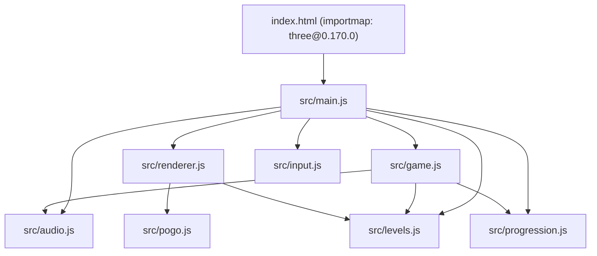

# TOWER TOPPLER '26 — ARCHITECTURE & MODULE INTERFACE CONTRACT
**Status:** Authoritative Engineering Specification (Single Source of Truth)  
**Scope:** Exact ES Module exports, class/method signatures, shared state schemas, and DOM contracts across all files in `Tower Toppler 26`.

> **CRITICAL RULE FOR ALL IMPLEMENTATION AGENTS:**  
> 1. Do **NOT** append cache-busting query strings (e.g., `?v=6`) to internal `import` statements inside `src/*.js`. Every internal module MUST use clean relative paths (`'./audio.js'`, `'./progression.js'`, `'./levels.js'`, `'./pogo.js'`, `'./input.js'`, `'./renderer.js'`, `'./game.js'`) so singletons (`sound`, `progression`) instantiate **exactly once**.  
> 2. Preserve every exported symbol, method name, parameter order, and object key defined in this contract so parallel module implementations integrate with **zero runtime or interface errors**.

---

## 1. Module Dependency DAG (Zero Circular Imports)



- **Leaf Modules (no internal `src/` imports):** `src/pogo.js` (imports `'three'`), `src/levels.js`, `src/input.js`, `src/progression.js`, `src/audio.js`.
- **Mid-Tier Modules:** `src/renderer.js`, `src/game.js`.
- **Top-Level Orchestrator:** `src/main.js`.

---

## 2. Shared Data Schemas

### 2.1 Enumerations & Settings Object (`SettingsObject`)
```js
// Era: 'reboot' | 'original'
// ControlMode: 'gesture' | 'joystick' | 'dpad' | 'tilt'
// GameMode: 'title' | 'tower' | 'topple' | 'submarine' | 'skimmer' | 'vault' | 'paused' | 'gameover' | 'victory'
// RunType: 'reboot_campaign' | 'original_campaign' | 'endless' | 'daily' | 'minigame'

const defaultSettings = {
  era: 'reboot',              // 'reboot' | 'original'
  controlMode: 'gesture',     // 'gesture' | 'joystick' | 'dpad' | 'tilt'
  zenMode: false,             // boolean (Casual Zen modifier)
  muted: false,               // boolean (Master audio mute)
  musicEnabled: true,         // boolean (Music bus toggle)
  hapticsEnabled: true,       // boolean (navigator.vibrate)
  tiltSensitivity: 1.0,       // number (0.5 .. 2.0)
  skinId: 'default_amphibian' // active Pogo skin ID
};
```

### 2.2 Tower Definition Schema (`TowerDefinition`)
Returned by all builders/generators in `src/levels.js`:
```js
{
  id: 1,                                // 1-based tower index (1..8 in campaigns, 1..N in endless)
  key: 'reboot_t1',                     // unique cache/save key ('reboot_t1'..'reboot_t8', 'orig_t1'..'orig_t8', 'daily_20261116', 'endless_1_98712')
  era: 'reboot',                        // 'reboot' | 'original'
  name: 'WATCHTOWER OF THE MIST',       // uppercase display title
  subtitle: 'SECTOR I • STORM APPROACH',// optional banner subtitle
  theme: 'mist',                        // 'mist' | 'sinking' | 'foundry' | 'blizzard' | 'prism' | 'piston' | 'blackout' | 'apex' | 'classic'
  floors: 18,                           // total cylinder height in floors
  timeLimit: 95,                        // countdown seconds
  parTime: 35,                          // seconds remaining needed for Speed Star Core
  spawn: { col: 0, floor: 0 },          // spawn column (0..15) & floor
  palette: {
    brickA: '#242544',
    brickB: '#2f325b',
    mortar: '#0d0e1d',
    ledge: '#525b70',
    ledgeTop: '#73809c',
    glow: '#5efce8',
    // Optional Reboot atmospheric overrides (renderer supplies defaults if omitted):
    moss: '#365e30',
    pipe: '#3b3538',
    skyTop: '#060a14',
    skyMid: '#101b30',
    fog: '#0b1526',
    water: '#091926',
    foam: '#e8f6ff'
  },
  mechanics: {
    waterBaseFloor: -0.55,              // default -0.55
    waterRiseRate: 0,                   // > 0 in Sinking/Apex towers (floors/s, e.g. 0.18)
    windForce: 0,                       // peak horizontal push in cols/s (e.g. 1.4 in Blizzard Spire)
    windPeriod: 6.0,                    // seconds per gust cycle
    blackoutCycle: 0,                   // > 0 dims ambient lighting periodically (seconds)
    lightningInterval: 0                // > 0 triggers storm lightning flashes (seconds)
  },
  ledges: [
    {
      col: 0,                           // 0..15
      floor: 0,
      type: 'solid',                    // 'solid' | 'crumble' | 'ice' | 'conveyorL' | 'conveyorR' | 'box' | 'laserGate' | 'phaseBlock' | 'piston' | 'steamVent'
      switchGroup: null,                // optional string ('red' | 'cyan' | 'conv') linking to switches
      inverted: false,                  // if true, starts active/open when switchGroup is false
      phasePeriod: 3.2,                 // used by 'piston' / 'steamVent'
      phaseOffset: 0                    // phase offset in seconds
    }
  ],
  elevators: [
    { col: 8, minFloor: 12, maxFloor: 15, startFloor: 12, speed: 1.5 }
  ],
  doors: [
    {
      id: 'd1a',
      col: 12,
      floor: 6,
      targetId: 'd1b',                  // null if isExit or isVault
      isExit: false,                    // true on summit crown exit doorway
      isVault: false,                   // true on hidden Core Lock Vault door
      tunnelStyle: 'stone'              // 'stone' (misty stone lintel) | 'sparkArch' (spark-showering arched side tunnel)
    }
  ],
  switches: [
    {
      id: 'sw1',
      col: 5,
      floor: 4,
      group: 'red',                     // toggles matching ledges or triggers action
      mode: 'toggle'                    // 'toggle' | 'drainValve' | 'conveyorFlip'
    }
  ],
  collectibles: [
    { id: 'c1', col: 9, floor: 7, type: 'gear' } // 'gear' | 'starCore'
  ],
  enemies: [
    {
      type: 'eye',                      // 'eye' | 'molecule' | 'roller' | 'bouncer' | 'robotH' | 'robotV'
      col: 2,
      floor: 11.4,
      dir: 1,                           // 1 | -1
      speed: 1.6,
      amp: 0.4,                         // vertical bob/bounce amplitude
      minFloor: null,                   // used by 'robotV'
      maxFloor: null
    }
  ]
}
```

### 2.3 Shared Render State (`RenderState` — passed to `GameRenderer`)
`TowerTopplerGame` passes `this` (conforming to `RenderState`) to `renderer.renderScene(this)`:
```js
{
  era: 'reboot',                        // 'reboot' | 'original'
  mode: 'tower',                        // GameMode
  pausedFrom: null,                     // underlying active mode when paused
  runType: 'reboot_campaign',           // RunType
  zenMode: false,
  time: 0,                              // elapsed seconds
  timer: 92,                            // remaining seconds
  shake: 0,                             // scalar camera shake intensity (0..18)
  waterFloor: -0.55,                    // live ocean surface height in floor units (rises in Sinking Tower!)
  windCurrent: 0,                       // current horizontal wind velocity (-1.5 .. +1.5 cols/s)
  blackoutFactor: 0,                    // 0 (normal) .. 1 (blackout darkness)
  lightningFlash: 0,                    // 0 .. 1 decaying lightning flash intensity
  switchStates: { red: false, cyan: false, conv: false },
  tower: TowerDefinition,
  camCol: 0,
  camFloor: 2,
  player: {
    col: 0.5,
    floor: 0,
    vx: 0,
    vy: 0,
    facing: 1,                          // 1 (right) | -1 (left)
    onGround: true,
    onElevator: null,
    invuln: 0,
    shield: false,                      // earned from Sub Warp Cave / Vault
    hidden: false,
    enteringDoor: 0,                    // 0..1 door transition blend
    tunnelTimer: 0,
    fireCooldown: 0,
    muzzleFlash: 0,
    squashX: 1,
    squashY: 1,
    landImpact: 0,                      // 0..1 skeletal knee-compression impulse
    hurtTimer: 0,
    landingFloor: 0,
    skinId: 'default_amphibian'
  },
  ledges: [],                           // runtime clones with { ...l, crumbling, crumbleTimer, shake, gone, active, pistonExt, steamActive }
  elevators: [],                        // runtime clones with { ...e, floor, dir, recallTarget }
  switches: [],                         // runtime clones with { ...s, active, cooldown }
  collectibles: [],                     // runtime clones with { ...c, collected }
  enemies: [],                          // runtime clones with { ...en, baseFloor, phase, stunTimer, dead }
  snowballs: [],                        // [{ col, floor, dir, life }]
  particles: [],                        // [{ x, y, col?, floor?, vx, vy, gravity, size, color, life, maxLife }]
  popups: [],                           // [{ col, floor, x, y, text, color, life, maxLife }]
  topple: { active: false, progress: 0, duration: 2.6 },

  // Mini-Game A: MK.7 Sub-Hunter
  sub: {
    x: 120, y: 220, vx: 0, vy: 0,
    timer: 0, duration: 16,
    warpCave: { x: 900, y: 95, active: true, entered: false },
    bubbles: [],                        // [{ x, y, vx }]
    fish: [],                           // [{ x, y, vx, color, bubbled, caught, isGear }]
    mines: []                           // [{ x, y, vx, hp, phase }]
  },

  // Mini-Game B: Hydro-Skimmer Run
  skimmer: {
    laneX: 0,                           // -3.5 .. +3.5 world lateral position
    vx: 0,
    y: 0,                               // height above wave surface
    vy: 0,
    onWater: true,
    speed: 18,                          // forward world units/s
    boostMult: 1,                       // 1..4
    boostTimer: 0,
    distance: 0,
    timer: 0,
    duration: 18,
    gates: [],                          // [{ z, laneX, width, hit }] (z = relative distance ahead of player, 0 = at skimmer)
    ramps: [],                          // [{ z, laneX, width, used }]
    hazards: [],                        // [{ z, laneX, type: 'mine' | 'crate' | 'rock', hp }]
    gears: [],                          // [{ z, laneX, y, collected }]
    bolts: []                           // [{ z, laneX, y }]
  },

  // Mini-Game C: Core Lock Vault
  vault: {
    activeRing: 0,                      // 0, 1, 2
    strikes: 0,
    maxStrikes: 3,
    timer: 12.0,
    duration: 12.0,
    status: 'playing',                  // 'playing' | 'won' | 'failed'
    statusTimer: 0,
    rings: [
      { angle: 0, speed: 1.65, targetAngle: 0, tolerance: 0.38, locked: false },
      { angle: 1.8, speed: -2.35, targetAngle: 0, tolerance: 0.35, locked: false },
      { angle: 3.5, speed: 3.10, targetAngle: 0, tolerance: 0.32, locked: false }
    ]
  }
}
```

### 2.4 HUD Callback Payload (`HudPayload` — passed to `callbacks.onHud(hud)`)
```js
{
  era: 'reboot',                        // 'reboot' | 'original'
  mode: 'tower',                        // GameMode
  runType: 'reboot_campaign',           // RunType
  zenMode: false,
  score: 4520,
  hiScore: 18400,
  lives: 3,                             // integer 0..6
  gears: 42,                            // total Golden Gears owned
  timer: 92.4,                          // remaining seconds (or elapsed in zenMode)
  timeLimit: 95,                        // max seconds for circular ring ratio (timer / timeLimit)
  towerId: 1,
  towerName: 'WATCHTOWER OF THE MIST',
  dirHint: '▲',                         // '◀' | '▲' | '▶'
  altitudePct: 24,                      // 0..100
  waterPct: 0,                          // 0..100 (rising sea danger bar on altitude meter!)
  actionPrompt: null,                   // string | null (e.g. '▲ ENTER DOORWAY', '▲ CRACK VAULT', '▲▼ CAGE LIFT', '❄️ CALL LIFT')
  boostMult: 1                          // 1..4 (displayed during skimmer mode)
}
```

---

## 3. Module-by-Module Interface Contracts

### 3.1 `src/pogo.js` — Hierarchical Skeletal Hero & Skins
```js
export const POGO_SKINS = [
  // 8 skin objects:
  // { id, name, bodyColor, bellyColor, crestColor, harnessColor, packColor, eyeGlow, accentColor, metallic }
  // IDs MUST be:
  // 'default_amphibian', 'deep_diver', 'poison_dart', 'clockwork_brass',
  // 'frost_warden', 'shadow_infiltrator', 'retro_1987', 'golden_toppler'
];

export class PogoRig {
  /** @param {string} [skinId='default_amphibian'] */
  constructor(skinId = 'default_amphibian');

  /** Root THREE.Group to add into scene. */
  group; // THREE.Group

  /** Named bone dictionary:
   *  { root, pelvis, spine, chest, neck, head, crest, browL, browR,
   *    eyeL, eyeR, eyelidL, eyelidR, jaw, harness, backpack,
   *    shoulderL, upperArmL, forearmL, handL,
   *    shoulderR, upperArmR, forearmR, handR, blaster, muzzle, muzzleLight,
   *    thighL, shinL, footL, thighR, shinR, footR }
   */
  bones;

  /** Applies one of the 8 skin palettes/materials live without recreating geometry. */
  setSkin(skinId);

  /** Adjusts material roughness/glossiness between 'reboot' (organic damp amphibian + leather) and 'original' (glossy 2008 HD arcade). */
  setEraStyle(era);

  /** Procedural skeletal pose update called once per frame.
   *  @param {number} dt - frame delta seconds
   *  @param {object} poseState - { time, vx, vy, facing, onGround, onElevator, squashX, squashY, landImpact, muzzleFlash, hurtTimer, invuln, enteringDoor, victory }
   */
  update(dt, poseState);

  /** Cleanly disposes geometries/materials if needed. */
  dispose();
}
```

---

### 3.2 `src/renderer.js` — Dual-Era Three.js WebGL2 Renderer & 3 Mini-Games
```js
export class GameRenderer {
  /** @param {HTMLCanvasElement} canvas */
  constructor(canvas);

  width;  // number (CSS pixels)
  height; // number (CSS pixels)
  era;    // 'reboot' | 'original'

  /** Resizes WebGLRenderer, EffectComposer, UnrealBloomPass, and all scene cameras. */
  resize(w, h, dpr = 1);

  /** Switches lighting, sky/moon/fireflies vs retro nebula, stone/corbel/cage-lift vs glossy arcade materials. */
  setEra(era);

  /** Updates PogoRig skin in Tower, Sub-Hunter, and Hydro-Skimmer scenes. */
  setSkin(skinId);

  /** Unified scene dispatcher based on state.mode / state.pausedFrom. */
  renderScene(state);

  /** Individual scene renderers (kept public for clarity & backwards compatibility): */
  renderTowerScene(state);      // Full-bleed moonlit storm tower (or Original 2008 HD tower), rising sea, weather, PogoRig, enemies
  renderSubmarineScene(state);  // Mini-Game A: 3D underwater trench, MK.7 sub, fish, mines, bioluminescent warp cave
  renderSkimmerScene(state);    // Mini-Game B: 3D chase-cam moonlit ocean slalom, boost gates, wave ramps, mines
  renderVaultScene(state);      // Mini-Game C: 3D concentric brass/crystal tumbler rings + Star Core vault
}
```

---

### 3.3 `src/input.js` — 4-Mode Concise Touch, Tilt & Keyboard Controller
```js
export const CONTROL_MODES = ['gesture', 'joystick', 'dpad', 'tilt'];

export class InputController {
  /** @param {{ mode?: string, hapticsEnabled?: boolean }} [options] */
  constructor(options = {});

  state; // { left: boolean, right: boolean, up: boolean, down: boolean, jump: boolean, fire: boolean, analogX: number, analogY: number }
  justPressed; // { up: boolean, down: boolean, jump: boolean, fire: boolean }
  controlMode; // 'gesture' | 'joystick' | 'dpad' | 'tilt'
  tiltSupported; // boolean
  tiltPermissionGranted; // boolean
  tiltNeutralGamma; // number

  /** Switches active touch control scheme and sets document.getElementById('app').dataset.controlMode = mode. */
  setControlMode(mode);

  /** Enables/disables haptic vibration pulses. */
  setHapticsEnabled(enabled);

  /** Sets tilt sensitivity multiplier (0.5 .. 2.0). */
  setTiltSensitivity(mult);

  /** Requests iOS DeviceOrientationEvent permission if required; resolves true when active. */
  async requestTiltPermission();

  /** Captures current device roll angle as neutral 0° reference and returns it. */
  calibrateTilt();

  /** Consumes and resets a single-frame edge trigger ('up' | 'down' | 'jump' | 'fire'). */
  consumeJustPressed(action);

  /** Clears all justPressed flags at the end of game.update(dt). */
  clearFrame();

  /** Clears all held directions/buttons (called on pause / overlay transitions). */
  resetState();

  /** Triggers subtle mobile vibration if hapticsEnabled is true. */
  haptic(pattern = 12);
}
```
**Strict Tuned Gesture Contract (`controlMode === 'gesture'`):**
- Horizontal drag (`|dx| > 10px`) → `state.left` / `state.right` + proportional `analogX` (with dynamic reversal re-anchoring).
- Controlled upward slide (`dy <= -26px`, upward speed `< 680 px/s` OR held `>= 105ms` without flick impulse) → `state.up = true` & `justPressed.up = true` (**MUST NEVER set `jump`!**).
- Controlled downward slide (`dy >= 26px`) → `state.down = true` & `justPressed.down = true`.
- Fast upward FLICK (`dy <= -20px` within `<= 115ms` AND upward velocity `<= -720 px/s`) → `justPressed.jump = true` & `state.jump = true` (released on pointerup or after `165ms`).
- Quick stationary TAP (`duration <= 195ms` AND total displacement `<= 12px`) → `justPressed.fire = true` & `110ms` `state.fire` pulse.

---

### 3.4 `src/levels.js` — 8 Reboot Towers, 8 Original Towers & Verified Procedural Generator
```js
export const COLS = 16;

/** Deterministic 32-bit PRNG returning () => float in [0, 1). */
export function mulberry32(seed);

/** Returns UTC daily challenge seed & ISO date key: { seed: 20261116, dateKey: '2026-11-16' }. */
export function getDailySeed(date = new Date());

/** Returns the 8 faithful Classic Towers (era: 'original'). */
export function createOriginalTowers();

/** Returns the 8 "Operation Nebulus" Story Campaign Towers (era: 'reboot', including Sinking Reliquary, Foundry, Boreal Spire, Prism Labyrinth, Piston Rig, Blackout Citadel, Apex). */
export function createRebootTowers();

/** Convenience dispatcher: era === 'original' ? createOriginalTowers() : createRebootTowers(). */
export function createTowers(era = 'reboot');

/** Chunk-based procedural generator with guaranteed solvability repair pass.
 *  @param {{ seed: number, index?: number, difficulty?: number, era?: string }} params
 *  @returns {TowerDefinition}
 */
export function generateProceduralTower({ seed, index = 1, difficulty = 1, era = 'reboot' });

/** Builds today's deterministic 20-floor Daily Challenge Tower. */
export function createDailyTower(date = new Date());

/** Runs BFS reachability verification across ledges, step-ups, jumps, elevators, doors, and switches.
 *  @returns {{ solvable: boolean, minSteps: number, reachableExit: boolean }}
 */
export function verifyTowerSolvable(tower);
```

---

### 3.5 `src/progression.js` — Saves, Star Cores, Golden Gears, 8 Skins & 16 Trophies
```js
export const SKIN_CATALOG = [
  // 8 entries matching POGO_SKINS IDs:
  // { id, name, description, gearCost, milestoneText, previewColors: [primary, secondary, accent] }
];

export const TROPHIES = [
  // 16 entries:
  // { id, title, description, icon }
  // IDs: 'first_topple', 'mist_walker', 'tide_runner', 'vault_cracker', 'sub_ace', 'warp_finder',
  //      'skimmer_pro', 'snowball_sniper', 'switch_architect', 'storm_ghost', 'speed_demon',
  //      'daily_climber', 'endless_5', 'classic_hero', 'operation_nebulus', 'nebulus_legend'
];

export class ProgressionManager {
  constructor(storageKey = 'tt26_save_v2');

  getSettings();
  updateSettings(partialSettings);

  getHighScore(bucket = 'reboot'); // 'reboot' | 'original' | 'endless' | 'daily'
  recordScore(bucket, score);

  getGears();
  addGears(amount);
  spendGears(amount); // returns boolean

  isSkinUnlocked(skinId);
  unlockSkin(skinId, useGears = false); // returns { unlocked: boolean, reason?: string }
  equipSkin(skinId);
  getEquippedSkin(); // returns skinId string

  /** Records tower completion & evaluates Star Cores + milestone skins/trophies.
   *  @param {{ era: string, towerId: number, clear: boolean, vault: boolean, speed: boolean, hurtCount: number, touchedWater: boolean }} data
   *  @returns {{ stars: { clear: boolean, vault: boolean, speed: boolean, count: number }, newlyUnlockedTrophies: object[], newlyUnlockedSkins: string[] }}
   */
  recordTowerClear(data);

  getTowerStars(era, towerId); // { clear: boolean, vault: boolean, speed: boolean, count: number }
  getTotalStars(era = null);   // sum of Star Cores (for one era or all eras if null)

  recordDailyResult({ dateKey, score, clearTimeSec, completed, altitudePct });
  getDailyRecord(dateKey); // { played: boolean, completed: boolean, bestScore: number, bestTimeSec: number | null }

  recordEndlessRun(towersCleared, score);
  getBestEndlessDepth();

  /** Unlocks trophy if not already unlocked; returns trophy def object on FIRST unlock, or null if already owned. */
  unlockTrophy(trophyId);
  isTrophyUnlocked(trophyId);
  getUnlockedTrophies(); // string[] of unlocked IDs

  resetProgress();
}

export const progression = new ProgressionManager();
```

---

### 3.6 `src/audio.js` — Dual-Era Studio Web Audio Synthesizer
```js
export class SoundEngine {
  constructor();

  muted;        // boolean
  musicEnabled; // boolean
  musicActive;  // boolean
  era;          // 'reboot' | 'original'

  unlock();
  setEra(era);                      // Switches soundbank & music groove ('reboot' cinematic storm-synth vs 'original' 2008 arcade)
  setTowerTheme(towerId = 1, theme = 'mist');
  setZenMode(zen = false);
  setMiniGameMode(mode = null);     // null | 'submarine' | 'skimmer' | 'vault'

  toggleMute();                     // returns muted boolean
  setMuted(muted);
  toggleMusic();                    // returns musicEnabled boolean
  setMusicEnabled(enabled);
  setMusicActive(active);

  // Core SFX (100% preserved + dual-era voiced):
  jump();
  land(intensity = 0.6);
  stepUp();
  snowball();
  bubble();
  hitEnemy();
  stunEnemy();
  catchFish();
  crumble();
  door();
  elevator();
  splash();
  hurt();
  towerTopple();
  extraLife();

  // 2026 Reboot Extended SFX:
  collectGear();
  collectStar();
  switchToggle();
  steamBurst();
  thunderCrack();
  boostGate(mult = 1);
  vaultTick(locked = false);
  vaultUnlock();
  vaultFail();
  trophyUnlock();
}

export const sound = new SoundEngine();
```

---

### 3.7 `src/game.js` — Core Gameplay, Physics, Campaign, Mini-Games & Endless/Daily Loop
```js
export class TowerTopplerGame {
  /**
   * @param {GameRenderer} renderer
   * @param {InputController} input
   * @param {{
   *   onHud?: (hud: HudPayload) => void,
   *   onBanner?: (sub: string, title: string) => void,
   *   onTrophy?: (trophy: object) => void,
   *   onGameOver?: (victory: boolean, score: number, hiScore: number, summary?: object) => void
   * }} callbacks
   * @param {ProgressionManager} [progressionMgr]
   */
  constructor(renderer, input, callbacks, progressionMgr = progression);

  /** Applies live settings (era, controlMode, zenMode, skinId, haptics, tiltSensitivity). */
  applySettings(settings);

  /** Starts Reboot or Original 8-Tower Campaign. */
  startCampaign({ era = this.era, startTowerIdx = 0, zenMode = this.zenMode } = {});

  /** Backwards-compatible alias calling startCampaign({ startTowerIdx }). */
  startNewGame(startTowerIdx = 0);

  /** Starts Procedural Endless Abyss climb. */
  startEndlessMode({ era = 'reboot', seed = Date.now() } = {});

  /** Starts UTC Daily Seeded Tower climb. */
  startDailyChallenge(date = new Date());

  /** Launches any of the 3 mini-games directly ('submarine' | 'skimmer' | 'vault') or in campaign transition. */
  startMiniGame(type = 'submarine', standalone = true);

  /** Loads a campaign tower index OR a direct TowerDefinition object (for preview, Endless, or Daily). */
  loadTower(idxOrTower);

  /** Pauses or resumes active gameplay ('tower' | 'submarine' | 'skimmer' | 'vault'); returns boolean isPaused. */
  togglePause();

  /** Advances simulation by dt seconds (clamped <= 0.05s) and clears input frame edges. */
  update(dt);

  /** Dispatches current state to renderer.renderScene(this). */
  render();
}
```
**Dual-Era Behavioral Rules in `TowerTopplerGame` (`this.era`):**
- **`era === 'reboot'` (per `docs/REBOOT_2026_DESIGN.md`):** Uses weighty 3-phase asymmetric gravity (`jumpVy = 9.5`, `gravityUp = 24.5`, `gravityDown = 37.0`), tower-specific environmental mechanics (`waterRiseRate`, `windForce`, `switch`+`laserGate`, `blackoutCycle`), hidden `isVault` doors launching *Core Lock Vault*, and inter-tower transitions alternating between *MK.7 Sub-Hunter* (`16s` with mines + warp cave) and *Hydro-Skimmer Run* (`18s` boost-gate slalom).
- **`era === 'original'` (per `docs/ORIGINAL_DESIGN.md`):** Uses classic symmetric arcade jump arc (`jumpVy = 7.6`, `gravity = 16.5`), classic snowball matrix (`box` & `roller` destroyed; `bouncer` stunned `3.0s`; `eye`, `molecule`, `robotH`, `robotV` immune), anti-stall vertical Eye drift after `7.5s`, C64 Technique Bonus, and pure `14s` *MK.7 Mini-Submarine* intermissions (two-step bubble-encase → hull-collect, zero mines).

---

### 3.8 `index.html` + `styles.css` + `src/main.js` — Full-Bleed UI & DOM Contract

#### Required Importmap in `index.html`
```html
<script type="importmap">
{
  "imports": {
    "three": "https://cdn.jsdelivr.net/npm/three@0.170.0/build/three.module.min.js",
    "three/addons/": "https://cdn.jsdelivr.net/npm/three@0.170.0/examples/jsm/"
  }
}
</script>
<script type="module" src="src/main.js"></script>
```

#### Required DOM Element IDs & Attributes
1. **Root & Canvas Viewport (Full-Bleed `100vw × 100dvh`):**
   - `#app` (`data-era="reboot|original"`, `data-control-mode="gesture|joystick|dpad|tilt"`)
   - `#stage-wrap` (full-bleed container), `#game-canvas` (WebGL2 canvas)
2. **Reference-Matched Top HUD (`#hud`):**
   - Top-Left: `#score-display` (`00004520`), `#lives-display` (alien-frog head SVG life icons `.life-pip`)
   - Top-Center: `#timer-display` (`092` integer or `∞`), `#timer-ring` + `#timer-ring-arc` (SVG depleting circular ring gauge), `#dir-arrow`, `#tower-badge`
   - Top-Right: `#hi-score-display` (`00000000` ghosted readout), `#gears-display`, `#btn-era-toggle`, `#btn-ctrl-mode`, `#btn-music`, `#btn-sound`, `#btn-pause`
3. **In-Stage Floating HUD Indicators:**
   - `#altitude-meter`, `#alt-fill`, `#alt-pip`, `#alt-water` (rising sea fill!)
   - `#action-prompt` (contextual pill above bottom edge)
   - `#stage-banner` (`#banner-sub`, `#banner-title`)
   - `#trophy-toast` (`#trophy-toast-title`)
4. **Minimal Translucent Ghosted Touch Controls (`#touch-controls`):**
   - Hairline vector overlays (`opacity: 0.24` idle → `0.65` active, zero opaque button fills!):
   - `#dpad` (`.dpad-btn[data-dir="up|down|left|right"]`, `#dpad-puck`)
   - `#joystick-zone` (`#joystick-ring`, `#joystick-puck`)
   - `#tilt-bar` (`#tilt-puck`, `#btn-calibrate-tilt`)
   - `#btn-fire`, `#btn-jump`
5. **Modal Overlays:**
   - `#overlay-title`: Era Switcher (`[data-era-select="reboot|original"]`), Mode Tabs / Buttons (`#btn-start`, `#btn-daily`, `#btn-endless`, `#btn-minigames`), `#toggle-zen`, `#start-tower`, Control Mode Selector (`#select-control-mode`), `#btn-wardrobe`, `#btn-trophies`.
   - `#overlay-wardrobe`: 8 Pogo Skins interactive grid (`#wardrobe-grid`), `#wardrobe-gears`, `#btn-close-wardrobe`.
   - `#overlay-trophies`: 16 Trophies + Star Core counter (`#trophies-grid`, `#total-stars-display`, `#btn-close-trophies`).
   - `#overlay-minigames`: Direct launch cards for *MK.7 Sub-Hunter*, *Hydro-Skimmer Run*, and *Core Lock Vault* (`#btn-close-minigames`).
   - `#overlay-pause`: `#pause-tower-name`, live Control Mode switcher (`#pause-control-mode`), `#btn-pause-calibrate`, `#btn-resume`, `#btn-restart`.
   - `#overlay-gameover`: `#go-badge`, `#go-title`, `#go-score`, `#go-hi`, `#go-stars`, `#go-gears`, `#btn-play-again`, `#btn-back-title`.
